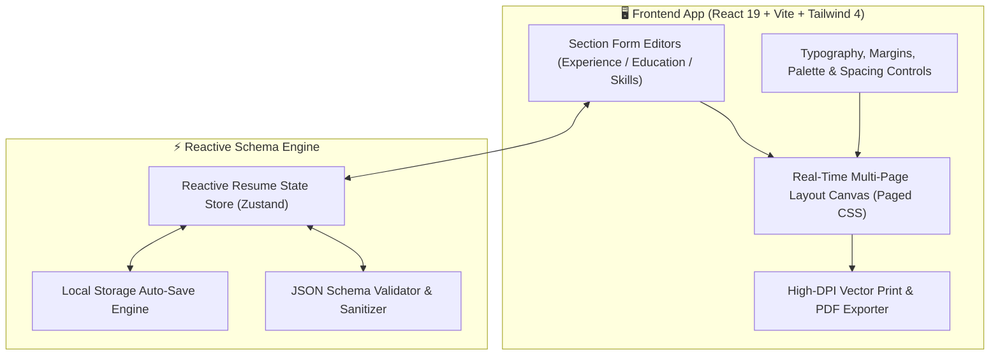
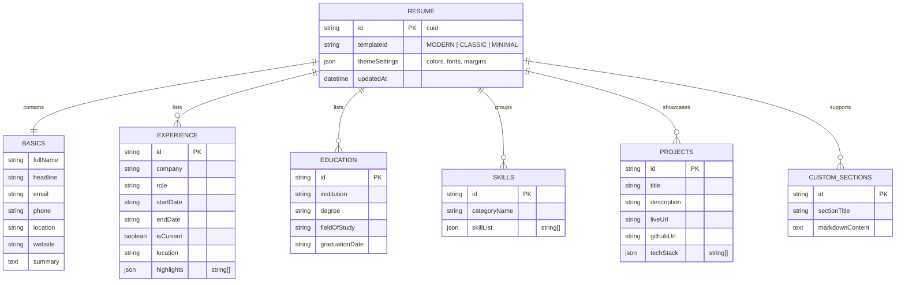
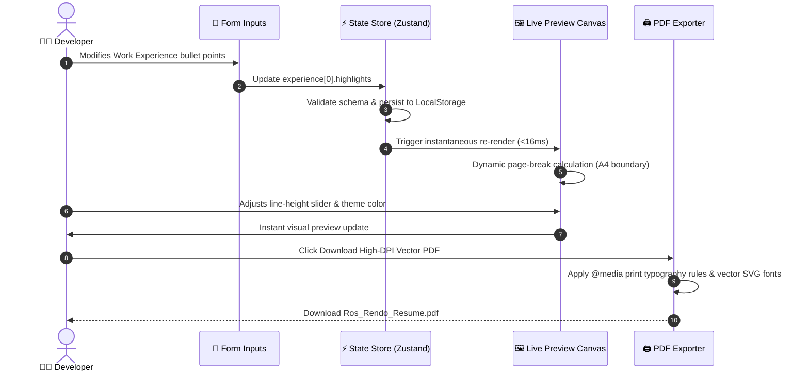

# 📄 CVGen — Reactive Career Document Engine & Multi-Page PDF Compiler

<div align="center">


**High-performance, reactive developer resume and CV synthesizer with real-time schema parsing, instant typography adjustments, and multi-page vector PDF generation.**

[System Architecture](#-system-architecture) • [Resume Schema ERD](#-reactive-resume-schema-erd) • [Compilation Flow](#-reactive-compilation--export-flow) • [Quick Start](#-quick-start)

</div>

---

## ⚡ Overview

**CVGen** is built for engineers and creatives who demand exact typographical control over their professional documentation. Featuring a reactive JSON schema architecture, it automatically balances section breaks, computes multi-page margins, and generates crisp, ATS-friendly vector PDF downloads directly inside the browser.

---

## 🏗️ System Architecture



---

## 📊 Reactive Resume Schema ERD



---

## 🔄 Reactive Compilation & Export Flow



---

## 🚀 Quick Start

### 1. Install Dependencies
```bash
pnpm install
```

### 2. Start Development Server
```bash
pnpm run dev
```

Visit `http://localhost:5173` to start creating your resume.

---

## 📄 License
MIT License © **[Ros Rendo](https://github.com/RosRendo)**
